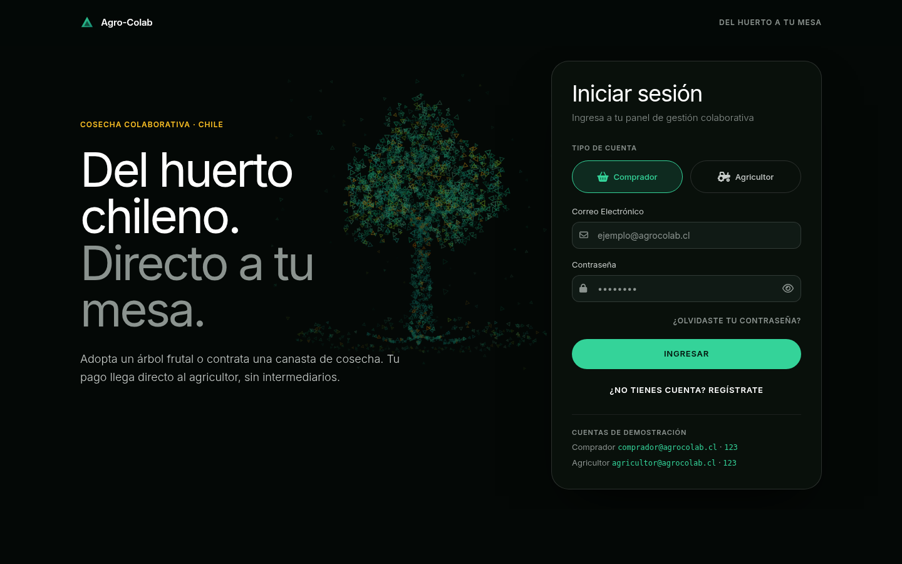
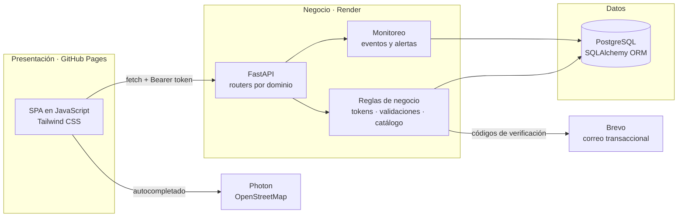

<div align="center">

# 🌱 Agro-Colab

**Financia la cosecha, asegura tu abastecimiento.**

Plataforma web full stack que conecta a consumidores con pequeños agricultores chilenos:
el cliente adopta un árbol frutal o contrata una canasta de cosecha, y el pago llega
directo al productor, sin intermediarios.

[](https://arrobaaas.github.io/agro-colab/)
[](https://github.com/arrobaaas/agro-colab/actions/workflows/pruebas.yml)
[](LICENSE)


<br>

<a href="https://arrobaaas.github.io/agro-colab/">
  
</a>

[Demo](https://arrobaaas.github.io/agro-colab/) ·
[Destacados](#-destacados-técnicos) ·
[Arquitectura](#-arquitectura) ·
[Seguridad](#-seguridad) ·
[Instalación](#-instalación-local) ·
[API](#-api-rest) ·
[Equipo](#-equipo)

</div>

---

## 🔎 Prueba la demo

**👉 [arrobaaas.github.io/agro-colab](https://arrobaaas.github.io/agro-colab/)**

| Rol | Correo | Contraseña |
|---|---|---|
| Comprador | `comprador@agrocolab.cl` | `123` |
| Agricultor | `agricultor@agrocolab.cl` | `123` |

> El backend corre en el plan gratuito de Render: si estuvo inactivo, la primera petición
> puede tardar alrededor de un minuto mientras el servidor despierta.

---

## 📋 El problema

El pequeño agricultor necesita capital **antes** de la temporada, y termina vendiendo su
cosecha a intermediarios que se quedan con buena parte del margen. Agro-Colab le permite
cobrar por adelantado, directamente al consumidor final, con dos líneas de producto:

| Línea | Qué compra el cliente | Planes |
|---|---|---|
| **Adopción de árboles** | Un cupo sobre un árbol concreto: es copropietario de su producción de temporada | Básico (5 personas) · Intermedio (3) · Premium (exclusivo) |
| **Abastecimiento** | Una canasta de cosecha con entrega programada a domicilio o a un local comercial | Dúo · Familiar · B2B (facturable) |

Cada pedido genera un código de seguimiento que lo vincula a su huerto de origen.

---

## ⭐ Destacados técnicos

- **Sin sobreventa bajo concurrencia.** La reserva de cupos es un `UPDATE` condicional atómico, respaldado por un índice único: dos compras simultáneas del último cupo nunca se aprueban ambas.
- **Seguridad aplicada de punta a punta.** Tokens firmados con HMAC-SHA256, autorización por recurso, *rate limiting* persistente, CSP estricta sin JavaScript en línea y defensa contra XSS en tres capas. [Ver detalle](#-seguridad).
- **Monitoreo y alertas propios.** Los eventos de seguridad se registran en base de datos y en logs JSON, y disparan alertas por correo o webhook según reglas (fuerza bruta, tokens falsificados, accesos a datos ajenos).
- **Calidad verificada en CI.** 39 pruebas automatizadas que GitHub Actions ejecuta en cada *push* contra **SQLite y PostgreSQL**, junto con una revisión de sintaxis del frontend.
- **Frontend sin frameworks.** SPA en JavaScript vanilla organizada en servicios, con router de vistas, delegación de eventos, gráficos accesibles hechos con HTML y CSS, y un árbol 3D de partículas en `<canvas>`.
- **Privacidad desde el diseño.** Cumplimiento de la Ley N° 21.719 de Protección de Datos Personales de Chile: consentimiento explícito, derechos de acceso, rectificación y eliminación, y registro de tratamiento.

---

## ✨ Funcionalidades

**Comprador**
- Catálogo de árboles con filtro por plan y cupos disponibles en tiempo real.
- Canasta de compra y pasarela de pago simulada: el monto lo fija el servidor y los datos de la tarjeta nunca se guardan.
- Planes de abastecimiento con destino particular o comercial (razón social y RUT).
- Panel de adopción: árboles adoptados, coparticipantes, cosecha estimada y cancelación de la suscripción.
- Autocompletado de direcciones reales con OpenStreetMap, sin geolocalizar el dispositivo.
- Registro con verificación por correo, recuperación de contraseña y eliminación completa de la cuenta.

**Agricultor**
- Panel con estadísticas y gráficos: ingresos por árbol, ocupación de cupos y adopciones por mes.
- Publicación de árboles desde un **catálogo cerrado de 12 especies**, con nombre compuesto automáticamente (por ejemplo, "Palto Hass #104").
- **Galería de 36 fotos verificadas** de Wikimedia Commons: el servidor rechaza cualquier imagen que no corresponda a la especie, incluso en peticiones hechas a mano. Así el comprador ve siempre el árbol correcto.
- Gestión de suscriptores: perfil de contacto y expulsión para liberar el cupo.

---

## 🏗 Arquitectura

Arquitectura cliente-servidor en tres capas. El frontend estático se publica en GitHub
Pages y consume una API REST en FastAPI desplegada en Render.



| Capa | Tecnologías | Responsabilidad |
|---|---|---|
| Presentación | HTML5, CSS3, JavaScript ES2020, Tailwind CSS | Vistas por rol en un único documento, sin recargas |
| Negocio | Python 3.12, FastAPI, Pydantic, bcrypt | Cupos, pagos, validación de especies e imágenes, autenticación y autorización |
| Datos | SQLAlchemy 2, PostgreSQL (SQLite en local) | Persistencia, restricciones de integridad y migraciones ligeras al arrancar |
| Infraestructura | GitHub Pages, Render, GitHub Actions, Brevo | Hosting, despliegue, integración continua y correo |

---

## 🔐 Seguridad

| Área | Implementación |
|---|---|
| Contraseñas | Hash con **bcrypt** y mínimo de 8 caracteres. Cambiarla exige la actual y cierra las demás sesiones |
| Sesión | **Tokens firmados con HMAC-SHA256**, con expiración de 7 días y ligados a la contraseña. Se guardan en `sessionStorage`, limitados a la pestaña |
| Autorización | Por recurso: cada usuario solo ve y modifica lo suyo. El usuario se toma siempre del token, nunca del cuerpo de la petición |
| Integridad | Precios fijados por el servidor y reserva de cupos atómica con índice único |
| XSS | Escape de todo dato insertado como HTML, rechazo de `<` y `>` en el backend y **Content-Security-Policy** sin `'unsafe-inline'` |
| Abuso | *Rate limiting* por IP real y por cuenta en login, registro y verificación, persistido en la base de datos |
| Cuentas | Verificación por correo con códigos generados con `secrets`. La recuperación no revela qué correos están registrados |
| Transporte | Cabeceras `nosniff`, `X-Frame-Options`, `Referrer-Policy` y `no-store`, y CORS restringido al frontend |

<details>
<summary><b>Registro de eventos, reglas de alerta y panel de monitoreo</b></summary>

<br>

Cada evento de seguridad se guarda en la tabla `eventos_seguridad` (30 días) y como una
línea JSON en los logs del servidor: logins fallidos y exitosos, tokens falsificados,
accesos a datos ajenos, bloqueos por *rate limit*, intentos de XSS, ataques a las cuentas
demo, cambios de contraseña y cuentas eliminadas. El navegador también reporta cuando la
CSP bloquea código (`POST /api/seguridad/csp`).

Cuando se cumple una regla se envía una alerta por correo o webhook, como máximo una vez
por hora por regla y origen:

| Regla | Se dispara con |
|---|---|
| Posible fuerza bruta | 5 logins fallidos contra una cuenta en 15 min |
| Tokens falsificados | 5 tokens inválidos desde una IP en 10 min |
| Acceso a datos ajenos | 5 accesos denegados desde una IP en 10 min |
| Ataque a cuentas demo | 3 intentos de modificarlas desde una IP en 30 min |
| Rate limit superado | 1 bloqueo |
| Intento de XSS | 1 texto con `<` o `>` |
| Bloqueo de CSP | 1 reporte del navegador |

El panel de monitoreo (`frontend/monitoreo.html`) muestra los eventos de las últimas 24
horas por tipo y severidad, y se actualiza cada 30 segundos. Pide el `MONITOREO_TOKEN`,
que se guarda solo en memoria.

</details>

<details>
<summary><b>Ley N° 21.719 de Protección de Datos Personales (Chile)</b></summary>

<br>

El proyecto incorpora desde el diseño los requisitos de la ley, vigente desde el 1 de
diciembre de 2026: consentimiento explícito al registrarse, [política de
privacidad](https://arrobaaas.github.io/agro-colab/frontend/privacidad.html) y derechos
de acceso, rectificación y eliminación desde el perfil del usuario.

**Delegado de Protección de Datos (DPO):** Nicolas Reyes Orellana · [@arrobaaas](https://github.com/arrobaaas)

| Dato | Finalidad | Base legal | Plazo |
|---|---|---|---|
| Nombre | Identificar al usuario | Consentimiento | Hasta eliminación |
| Email | Autenticación y comunicaciones | Consentimiento | Hasta eliminación |
| Contraseña (hash bcrypt) | Autenticación | Consentimiento | Hasta eliminación |
| Teléfono | Contacto de entrega | Consentimiento | Hasta eliminación |
| Dirección | Despacho de productos | Consentimiento | Hasta eliminación |
| Suscripciones | Gestión de adopciones | Contrato | Hasta eliminación |
| Pedidos | Gestión logística | Contrato | Hasta eliminación |
| IP, correo y acción en eventos de seguridad | Detectar y responder a ataques | Interés legítimo | 30 días |

| Derecho (Art. 20) | Cómo ejercerlo |
|---|---|
| Acceso y rectificación | Perfil de usuario |
| Eliminación | Botón "Eliminar mi cuenta" en el perfil |
| Oposición | Contactar al DPO |

**Notificación de brechas (Art. 22):** aviso a la Agencia de Protección de Datos dentro de
72 horas y a los usuarios afectados, con documentación del incidente y de las medidas
correctivas.

**Evaluación de impacto:** riesgo bajo. No se tratan datos sensibles, el volumen es
pequeño (prototipo académico) y las medidas mitigantes son el hash de contraseñas, el
consentimiento y el derecho a eliminación.

**Encargados del tratamiento:** GitHub Pages, Render y Brevo.

</details>

---

## 🧪 Pruebas e integración continua

**39 pruebas automatizadas** con pytest. GitHub Actions las ejecuta en cada *push* y
*pull request* dos veces, **con SQLite y con PostgreSQL**, y además revisa la sintaxis de
todo el JavaScript del frontend. Las pruebas usan una base temporal y nunca envían correos.

| Archivo | Qué cubre |
|---|---|
| `test_cuentas.py` | Registro y verificación, login, tokens alterados y recuperación de contraseña (sin enumeración de usuarios, código guardado como hash, bloqueo tras 5 errores y cierre de sesiones) |
| `test_pagos.py` | Aprobación y rechazo, monto fijado por el servidor, tarjetas inválidas, sin cobro si no hay cupo, número y CVV nunca guardados |
| `test_seguridad.py` | Autorización por recurso, cabeceras, rechazo de XSS, imágenes fuera del catálogo, cuentas demo protegidas, límite de intentos y borrado de datos |
| `test_base_datos.py` | Selección de la base de datos según las variables de entorno (SQLite local o PostgreSQL de Render) |

```bash
cd backend
pip install -r requirements-dev.txt
python -m pytest
```

---

## 🚀 Instalación local

**Requisitos:** Python 3.12 o superior y un navegador moderno.

```bash
git clone https://github.com/arrobaaas/agro-colab.git
cd agro-colab

# Backend → http://127.0.0.1:8000  (documentación interactiva en /docs)
cd backend
python3 -m venv venv
source venv/bin/activate          # Windows: venv\Scripts\activate
pip install -r requirements.txt
AGROCOLAB_MOD_MODE=desarrollo uvicorn main:app --reload --port 8000
```

```bash
# Frontend → http://localhost:3000  (en otra terminal)
cd frontend
python3 -m http.server 3000
```

Sin `DATABASE_URL` se usa una base SQLite local que se crea sola con las cuentas de
demostración y tres árboles de ejemplo. En modo `desarrollo` el código de verificación
aparece en la consola, así que se puede probar el registro sin configurar el correo.

Los estilos de Tailwind vienen compilados. Si agregas clases nuevas, vuelve a compilarlos
con `bash scripts/compilar-css.sh` (no requiere Node: descarga el ejecutable oficial y
verifica su checksum).

<details>
<summary><b>Variables de entorno</b></summary>

<br>

| Variable | Obligatoria | Descripción |
|---|---|---|
| `DATABASE_URL` | En producción | Conexión a PostgreSQL (`postgres://` o `postgresql://`). Sin ella se usa SQLite local |
| `AGROCOLAB_SECRET` | En producción | Clave para firmar los tokens. Si falta, se genera una al arrancar y las sesiones se cierran en cada reinicio |
| `AGROCOLAB_MOD_MODE` | No | `desarrollo` muestra el código de verificación sin enviar correo. Por defecto: `produccion` |
| `BREVO_API_KEY` | Para el registro en producción | Clave de la API de [Brevo](https://www.brevo.com) para enviar los códigos por correo |
| `CORREO_REMITENTE` | Junto con `BREVO_API_KEY` | Correo verificado en Brevo desde el que se envían los códigos |
| `ALERTA_CORREO` | No | Correo que recibe las alertas de seguridad |
| `ALERTA_WEBHOOK_URL` | No | Webhook de Discord o Slack para las alertas (`https://`) |
| `MONITOREO_TOKEN` | Para usar el panel | Token secreto (24 caracteres o más) del panel de monitoreo. Sin él, el panel está desactivado |

Sin `BREVO_API_KEY` y `CORREO_REMITENTE`, en producción el registro avisa que no está
disponible en lugar de crear cuentas que nadie podría verificar. Las cuentas de
demostración funcionan siempre.

</details>

---

## 🔌 API REST

Documentación interactiva (Swagger) en `/docs` al levantar el backend. Los endpoints
marcados con 🔒 exigen `Authorization: Bearer <token>`.

<details>
<summary><b>Ver todos los endpoints</b></summary>

<br>

| Método | Endpoint | Descripción |
|---|---|---|
| `POST` | `/api/register` | Registra una cuenta y envía el código de verificación |
| `POST` | `/api/verificar-cuenta` | Verifica la cuenta con el código de 6 dígitos |
| `POST` | `/api/reenviar-codigo` | Envía un código de verificación nuevo |
| `POST` | `/api/recuperar-contrasena` | Envía un código para restablecer la contraseña |
| `POST` | `/api/restablecer-contrasena` | Cambia la contraseña con el código y cierra las sesiones abiertas |
| `GET` | `/api/estado` | Indica si el envío real de correos está activo |
| `POST` | `/api/login` | Inicia sesión y devuelve el token |
| `GET` | `/api/especies` | Catálogo cerrado de especies con sus fotos verificadas |
| `GET` | `/api/arboles` | Catálogo público de árboles |
| `POST` | `/api/arboles` 🔒 | Publica un árbol (solo agricultores) |
| `PUT` | `/api/arboles/{id}` 🔒 | Edita un árbol (solo su productor) |
| `DELETE` | `/api/arboles/{id}` 🔒 | Elimina un árbol y sus suscripciones (solo su productor) |
| `POST` | `/api/pagos` 🔒 | Pasarela simulada: valida la tarjeta y adopta el árbol reservando el cupo de forma atómica |
| `GET` | `/api/pagos` 🔒 | Historial de pagos (marca y últimos 4 dígitos) |
| `POST` | `/api/cancelar-suscripcion` 🔒 | Cancela la suscripción propia y libera el cupo |
| `GET` | `/api/suscripciones/usuario/{id}` 🔒 | Árboles adoptados por el usuario |
| `GET` | `/api/mis-arboles/{id}/suscriptores` 🔒 | Suscriptores de los árboles del productor |
| `DELETE` | `/api/suscripciones/{id}` 🔒 | Expulsa a un suscriptor (solo el productor) |
| `POST` | `/api/pedidos` 🔒 | Registra un plan de abastecimiento o el despacho de una cosecha |
| `GET` | `/api/pedidos` 🔒 | Pedidos del usuario |
| `PUT` | `/api/pedidos/{id}` 🔒 | Modifica el destino y la frecuencia de un pedido propio |
| `DELETE` | `/api/pedidos/{id}` 🔒 | Cancela un plan de abastecimiento propio |
| `GET` | `/api/usuario/{id}` 🔒 | Perfil propio, o el de un suscriptor para su productor |
| `PUT` | `/api/perfil` 🔒 | Actualiza el perfil propio |
| `DELETE` | `/api/usuario/{email}` 🔒 | Elimina la cuenta propia y todos sus datos |

</details>

---

## 📁 Estructura del proyecto

<details>
<summary><b>Ver árbol de archivos</b></summary>

```
agro-colab/
├── frontend/
│   ├── index.html             # SPA: login y vistas de comprador y agricultor
│   ├── privacidad.html        # Política de privacidad (Ley 21.719)
│   ├── terminos.html          # Términos y condiciones
│   ├── monitoreo.html         # Panel de monitoreo de seguridad
│   ├── css/                   # Estilos propios y Tailwind compilado
│   └── js/
│       ├── app.js             # Arranque de la aplicación
│       ├── config.js          # URL de la API y vistas por rol
│       ├── api.js             # Cliente HTTP con token de sesión
│       ├── auth.js            # Sesión del usuario
│       ├── views.js           # Router de vistas
│       ├── acciones.js        # Delegación de eventos (sin onclick en el HTML)
│       ├── login.js           # Login, registro y verificación
│       ├── recuperacion.js    # Recuperación de contraseña
│       ├── parcelas.js        # Catálogo, canasta y logística del comprador
│       ├── pago.js            # Checkout de la pasarela simulada
│       ├── dashboard.js       # Panel del comprador
│       ├── agricultor.js      # Panel del agricultor
│       ├── graficos.js        # Gráficos accesibles con HTML y CSS
│       ├── catalogo.js        # Selector de especies y galería de fotos
│       ├── autocomplete.js    # Autocompletado de direcciones
│       ├── perfil.js          # Perfil de usuario
│       ├── dialogo.js         # Diálogos propios (reemplazan alert y confirm)
│       ├── efectos.js         # Animaciones de scroll e inclinación 3D
│       ├── constelacion.js    # Árbol 3D de partículas en canvas
│       ├── monitoreo.js       # Panel de monitoreo
│       ├── legal.js           # Efectos de las páginas legales
│       └── ui.js              # Alertas, formato de montos y escape de HTML
├── backend/
│   ├── main.py                # Aplicación FastAPI, CORS y routers
│   ├── core.py                # Esquemas, tokens y lógica compartida
│   ├── database.py            # Modelos SQLAlchemy y migraciones
│   ├── catalogo.py            # Catálogo de especies con fotos atribuidas
│   ├── seguridad.py           # Eventos, reglas de alerta y alertas
│   ├── notificaciones.py      # Correo transaccional (Brevo)
│   ├── routers/               # arboles, especies, suscripciones, pedidos, pagos, usuarios, monitoreo
│   └── tests/                 # Pruebas automatizadas (pytest)
├── .github/workflows/         # Integración continua
├── scripts/compilar-css.sh    # Compilación de Tailwind con verificación de checksum
├── docs/capturas/             # Capturas de pantalla
├── Informe.pdf                # Informe del proyecto
└── Presentacion.pptx          # Presentación del proyecto
```

</details>

---

## 🤖 Uso de Inteligencia Artificial

En este proyecto se usaron herramientas de IA como **apoyo**. Las decisiones de diseño,
la revisión del código y la responsabilidad sobre el resultado son del equipo.

| Herramienta | Período | Uso |
|---|---|---|
| **Gemini** (Google) | Septiembre 2026 | Estructura y redacción de los argumentos comerciales del informe |
| **ChatGPT** (OpenAI) | Septiembre 2026 | Comparación técnica de lenguajes (Node.js vs Python) y apoyo en el código del prototipo inicial |
| **Claude Code** (Anthropic) | Octubre 2026 | Asistente de programación: revisión de código, autenticación con tokens y autorización por recurso, corrección de la condición de carrera en la reserva de cupos, y documentación |

Los cambios propuestos por la IA se revisaron antes de incorporarlos, y los de seguridad
se probaron contra la API en ejecución: peticiones sin token o con token falso, acceso a
recursos de otros usuarios y compras simultáneas del último cupo. Las cifras del informe
se contrastaron con fuentes primarias del Ministerio de Agricultura.

---

## 👥 Equipo

| Integrante | GitHub |
|---|---|
| Nicolas Reyes Orellana | [@arrobaaas](https://github.com/arrobaaas) |
| Joaquin Alveal Santos | [@Joaquin-Alveal](https://github.com/Joaquin-Alveal) |
| Matias Gonzalez Paredes | [@SKT1-Ctrl](https://github.com/SKT1-Ctrl) |

Proyecto semestral del curso **INGT1003 Arquitectura de Desarrollo (Móvil y Web)** ·
Universidad Mayor · 2026

---

## 📄 Licencia

Código bajo [licencia MIT](LICENSE). Las fotografías del catálogo conservan sus licencias
originales de Wikimedia Commons (CC BY, CC BY-SA o dominio público), con autor y licencia
registrados por imagen. Dependencias, servicios y créditos en
[THIRD_PARTY_NOTICES.md](THIRD_PARTY_NOTICES.md).
