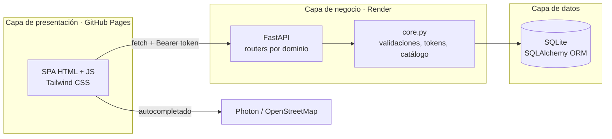

<div align="center">

# 🌱 Agro-Colab

**Financia la cosecha, asegura tu abastecimiento.**

Plataforma web que conecta a consumidores con pequeños agricultores chilenos mediante la
adopción de árboles frutales y la suscripción a canastas de cosecha, con trazabilidad
directa del huerto a la mesa y sin intermediarios.

[](https://arrobaaas.github.io/agro-colab/)
[](LICENSE)


[Demo](https://arrobaaas.github.io/agro-colab/) ·
[Funcionalidades](#-funcionalidades) ·
[Arquitectura](#-arquitectura) ·
[Instalación](#-instalación-local) ·
[API](#-api-rest) ·
[Seguridad](#-seguridad-y-protección-de-datos) ·
[Equipo](#-equipo)

</div>

---

## 📋 Sobre el proyecto

Agro-Colab nació como proyecto semestral del curso **INGT1003 Arquitectura de Desarrollo
(Móvil y Web)** de la Universidad Mayor (2026). Responde a un problema concreto: el pequeño
agricultor necesita financiamiento antes de la temporada y vende su cosecha a intermediarios
que se quedan con buena parte del margen. Agro-Colab le permite cobrar por adelantado,
directamente al consumidor final.

La plataforma ofrece dos líneas de producto:

| Línea | Qué compra el cliente | Unidad | Planes |
|---|---|---|---|
| **Adopción de árboles** | Un cupo sobre un árbol concreto: es copropietario de su producción de temporada | Cupo (copartícipe) | Básico (5 personas) · Intermedio (3) · Premium (exclusivo) |
| **Abastecimiento** | Una canasta de cosecha con entrega programada a domicilio o local comercial | Kilos por entrega | Dúo · Familiar · B2B (facturable) |

Cada pedido genera un código de seguimiento que lo vincula al huerto de origen.

> **Prueba la demo** con las cuentas de demostración:
> comprador `comprador@agrocolab.cl` / `123` · agricultor `agricultor@agrocolab.cl` / `123`

---

## ✨ Funcionalidades

**Para el comprador**
- Catálogo de árboles con filtro por plan y cupos disponibles en tiempo real.
- Adopción de árboles con control de cupos en el servidor: no hay sobreventa aunque varias personas compren a la vez.
- Contratación de canastas de abastecimiento con destino particular o comercial (razón social y RUT).
- Panel de adopción: árboles adoptados, coparticipantes, cosecha estimada, cancelación de la suscripción.
- Autocompletado de direcciones reales con OpenStreetMap, sin geolocalizar el dispositivo.
- Perfil editable y eliminación completa de la cuenta.

**Para el agricultor**
- Panel con estadísticas: árboles publicados, suscriptores e ingresos estimados.
- Publicación de árboles desde un **catálogo cerrado de 12 especies**: el nombre se compone automáticamente (por ejemplo, "Palto Hass" + "#104").
- **Galería de 36 fotos verificadas** de Wikimedia Commons. El servidor rechaza cualquier imagen que no pertenezca a la especie, incluso en peticiones hechas a mano.
- Gestión de suscriptores: ver su perfil de contacto y expulsarlos para liberar el cupo.

---

## 🏗 Arquitectura

Modelo cliente-servidor en tres capas. El frontend es una SPA en JavaScript vanilla
organizada en servicios; el backend es una API REST en FastAPI dividida en routers por
dominio.



| Capa | Tecnología | Responsabilidad |
|---|---|---|
| Presentación | HTML5, CSS3, JavaScript (ES2020), Tailwind CSS, Font Awesome | Vistas por rol en un único documento, sin recargas |
| Negocio | Python 3.12, FastAPI, Pydantic | Reglas de cupos, validación de especies e imágenes, autenticación |
| Datos | SQLAlchemy 2, SQLite | Persistencia, restricciones de integridad y migraciones ligeras al arrancar |

---

## 📁 Estructura del proyecto

```
agro-colab/
├── index.html                 # Redirección a frontend/ para GitHub Pages
├── frontend/
│   ├── index.html             # SPA: login y vistas de comprador y agricultor
│   ├── privacidad.html        # Política de privacidad (Ley 21.719)
│   ├── terminos.html          # Términos y condiciones
│   ├── css/styles.css
│   └── js/
│       ├── config.js          # URL de la API y vistas por rol
│       ├── api.js             # Cliente HTTP: adjunta el token de sesión
│       ├── auth.js            # Sesión en localStorage
│       ├── views.js           # Router de vistas
│       ├── login.js           # Login, registro y verificación de cuenta
│       ├── parcelas.js        # Catálogo, carrito y logística del comprador
│       ├── dashboard.js       # Panel de adopción del comprador
│       ├── agricultor.js      # Panel del agricultor
│       ├── catalogo.js        # Selector de especies y galería de fotos
│       ├── autocomplete.js    # Autocompletado de direcciones (Photon)
│       ├── perfil.js          # Perfil de usuario
│       ├── ui.js              # Alertas y formato de montos
│       └── app.js             # Arranque de la aplicación
├── backend/
│   ├── main.py                # Aplicación FastAPI, CORS y registro de routers
│   ├── core.py                # Esquemas, tokens de sesión y lógica compartida
│   ├── database.py            # Modelos SQLAlchemy y migraciones
│   ├── catalogo.py            # Catálogo cerrado de especies con fotos atribuidas
│   ├── routers/               # arboles, especies, suscripciones, pedidos, usuarios
│   └── requirements.txt
├── Informe.pdf                # Informe del proyecto
├── Presentacion.pptx          # Presentación del proyecto
├── LICENSE
└── THIRD_PARTY_NOTICES.md
```

---

## 🚀 Instalación local

**Requisitos:** Python 3.12 o superior y un navegador moderno.

```bash
git clone https://github.com/arrobaaas/agro-colab.git
cd agro-colab

# Backend (http://127.0.0.1:8000)
cd backend
python3 -m venv venv
source venv/bin/activate          # Windows: venv\Scripts\activate
pip install -r requirements.txt
uvicorn main:app --reload --port 8000
```

En otra terminal:

```bash
# Frontend (http://localhost:3000)
cd frontend
python3 -m http.server 3000
```

La base de datos SQLite (`backend/agrocolab.db`) se crea sola al primer arranque, con las
cuentas de demostración y tres árboles de ejemplo. La documentación interactiva de la API
queda en `http://127.0.0.1:8000/docs`.

### Variables de entorno

| Variable | Obligatoria | Descripción |
|---|---|---|
| `AGROCOLAB_SECRET` | En producción | Clave para firmar los tokens de sesión. Si falta, se genera una al arrancar y las sesiones se cierran en cada reinicio. |
| `AGROCOLAB_MOD_MODE` | No | `desarrollo` devuelve el código de verificación de cuenta en la respuesta, para probar el registro sin correo. Por defecto: `produccion`. |

---

## 🔌 API REST

Los endpoints marcados con 🔒 exigen el header `Authorization: Bearer <token>`, que se
obtiene al iniciar sesión. El usuario se toma siempre del token, nunca del cuerpo de la
petición.

| Método | Endpoint | Descripción |
|---|---|---|
| `POST` | `/api/register` | Registra una cuenta y envía el código de verificación |
| `POST` | `/api/verificar-cuenta` | Verifica la cuenta con el código de 6 dígitos |
| `POST` | `/api/login` | Inicia sesión y devuelve el token |
| `GET` | `/api/especies` | Catálogo cerrado de especies con sus fotos verificadas |
| `GET` | `/api/arboles` | Catálogo público de árboles |
| `POST` | `/api/arboles` 🔒 | Publica un árbol (solo agricultores) |
| `PUT` | `/api/arboles/{id}` 🔒 | Edita un árbol (solo su productor) |
| `DELETE` | `/api/arboles/{id}` 🔒 | Elimina un árbol y sus suscripciones (solo su productor) |
| `POST` | `/api/suscribir` 🔒 | Adopta un árbol reservando un cupo de forma atómica |
| `POST` | `/api/cancelar-suscripcion` 🔒 | Cancela la suscripción propia y libera el cupo |
| `GET` | `/api/suscripciones/usuario/{id}` 🔒 | Árboles adoptados por el usuario |
| `GET` | `/api/mis-arboles/{id}/suscriptores` 🔒 | Suscriptores de los árboles del productor |
| `DELETE` | `/api/suscripciones/{id}` 🔒 | Expulsa a un suscriptor (solo el productor) |
| `POST` | `/api/pedidos` 🔒 | Registra un pedido de abastecimiento |
| `GET` | `/api/pedidos` 🔒 | Pedidos del usuario |
| `GET` | `/api/usuario/{id}` 🔒 | Perfil propio, o el de un suscriptor para su productor |
| `PUT` | `/api/perfil` 🔒 | Actualiza el perfil propio |
| `DELETE` | `/api/usuario/{email}` 🔒 | Elimina la cuenta propia y todos sus datos |

---

## 🔐 Seguridad y protección de datos

**Medidas implementadas**
- Contraseñas hasheadas con **bcrypt**. Las bases antiguas con texto plano se migran solas al arrancar.
- **Tokens de sesión firmados con HMAC-SHA256**, con expiración de 7 días.
- **Autorización por recurso:** cada usuario solo ve y modifica lo suyo, y solo el productor ve los datos de contacto de sus suscriptores.
- **Integridad de cupos:** la reserva se hace con un `UPDATE` condicional atómico, y un índice único impide que un usuario ocupe dos cupos del mismo árbol.
- **Rate limiting** por IP en login, registro y verificación de cuenta.
- **CORS** restringido a los orígenes conocidos del frontend.
- Validación en el servidor de especies e imágenes del catálogo.

**Ley N° 21.719 de Protección de Datos Personales (Chile)**

El proyecto incorpora desde el diseño los requisitos de la ley, vigente desde el 1 de
diciembre de 2026: consentimiento explícito al registrarse, [política de
privacidad](https://arrobaaas.github.io/agro-colab/privacidad.html) y los derechos de
acceso, rectificación y eliminación desde el perfil del usuario.

<details>
<summary><b>Registro de actividades de tratamiento, DPO y protocolo de brechas</b></summary>

**Delegado de Protección de Datos (DPO):** Nicolas Reyes Orellana · [@arrobaaas](https://github.com/arrobaaas)

| Dato | Finalidad | Base legal | Plazo |
|---|---|---|---|
| Nombre | Identificar al usuario | Consentimiento | Hasta eliminación |
| Email | Autenticación y comunicaciones | Consentimiento | Hasta eliminación |
| Contraseña (hash bcrypt) | Autenticación | Consentimiento | Hasta eliminación |
| Teléfono | Contacto de entrega | Consentimiento | Hasta eliminación |
| Dirección | Despacho de productos | Consentimiento | Hasta eliminación |
| Suscripciones | Gestión de adopciones | Contrato | Hasta eliminación |
| Pedidos | Gestión logística | Contrato | Hasta eliminación |

| Derecho (Art. 20) | Cómo ejercerlo |
|---|---|
| Acceso | Perfil de usuario |
| Rectificación | Perfil de usuario |
| Eliminación | Botón "Eliminar mi cuenta" en el perfil |
| Oposición | Contactar al DPO |

**Protocolo de notificación de brechas (Art. 22):** notificación a la Agencia de Protección
de Datos dentro de 72 horas, aviso directo a los usuarios afectados, documentación del
incidente y de las medidas correctivas.

**Evaluación de impacto (DPIA):** riesgo bajo. No se tratan datos sensibles, el volumen es
pequeño (prototipo académico) y las medidas mitigantes son el hash de contraseñas, el
consentimiento y el derecho a eliminación.

**Encargados del tratamiento:** GitHub Pages ([términos](https://docs.github.com/en/site-policy/github-terms/github-terms-of-service)) y Render ([términos](https://render.com/legal/terms)).

</details>

---

## 🗺 Hoja de ruta

- [x] Catálogo de árboles y adopción con control de cupos
- [x] Planes de abastecimiento con logística particular y comercial
- [x] Catálogo cerrado de especies con imágenes verificadas
- [x] Panel del comprador y panel del agricultor
- [x] Persistencia con SQLAlchemy y SQLite
- [x] Autenticación con tokens y autorización por recurso
- [ ] Pasarela de pago (simulada)
- [ ] Migración a PostgreSQL
- [ ] Envío real del correo de verificación
- [ ] Fotos propias del productor con flujo de moderación
- [ ] Pruebas automatizadas e integración continua

---

## 🤖 Declaración de uso de Inteligencia Artificial

En este proyecto se usaron herramientas de IA como **apoyo**. Las decisiones de diseño,
la revisión del código y la responsabilidad sobre el resultado son del equipo.

| Herramienta | Período | Uso |
|---|---|---|
| **Gemini** (Google) | Septiembre 2026 | Estructura y redacción de los argumentos comerciales del informe |
| **ChatGPT** (OpenAI) | Septiembre 2026 | Comparación técnica de lenguajes (Node.js vs Python) y apoyo en el código del prototipo inicial |
| **Claude Code** (Anthropic, modelo Claude Opus 5.5) | Octubre 2026 | Asistente de programación en la terminal: revisión de código en busca de fallas, rediseño de las tarjetas de suscripción, implementación de la autenticación con tokens y la autorización por recurso, corrección de la condición de carrera en la reserva de cupos, y redacción de esta documentación y de los avisos de licencias |

**Cómo se verificó**
- Las cifras sobre el abandono del campo y las tendencias de consumo en Chile se contrastaron a mano con las fuentes primarias del Ministerio de Agricultura y con las revistas sectoriales citadas en el informe.
- Los cambios de código propuestos por la IA se revisaron antes de incorporarlos. Los de seguridad se probaron contra la API en ejecución: peticiones sin token o con token falso, acceso a recursos de otros usuarios y compras simultáneas del último cupo.

---

## 👥 Equipo

- Joaquin Alveal Santos - [@Joaquin-alveal](https://github.com/Joaquin-Alveal)
- Matias Gonzalez Paredes - [@Skt1-Ctrl](https://github.com/SKT1-Ctrl)
- Nicolas Reyes Orellana - [@arrobaaas](https://github.com/arrobaaas)

Proyecto semestral · INGT1003 Arquitectura de Desarrollo (Móvil y Web) · Universidad Mayor · 2026

---

## 📄 Licencia

El código se distribuye bajo la [licencia MIT](LICENSE). Las fotografías del catálogo
conservan sus licencias originales de Wikimedia Commons (CC BY, CC BY-SA o dominio
público), con autor y licencia registrados por imagen. Las dependencias, servicios y
créditos de cada foto están en [THIRD_PARTY_NOTICES.md](THIRD_PARTY_NOTICES.md).
